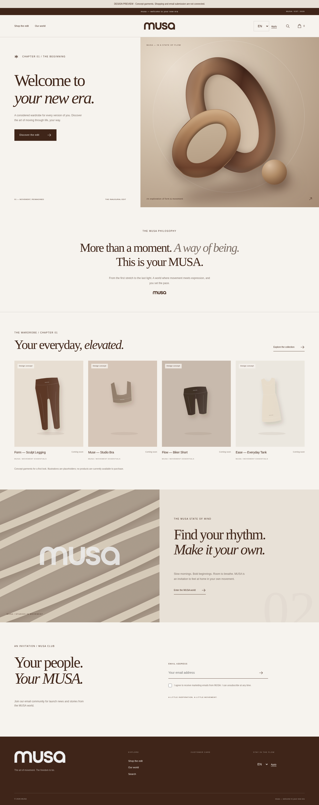

# MUSA — Atelier

Custom Shopify Online Store 2.0 theme for `kypp5e-bz.myshopify.com`.
Warm editorial art direction, original supplied wordmarks, responsive layouts, English and Spanish storefront strings, native Shopify commerce forms, and editable sections.

Brand signature: **musa — welcome to your new era**.



Offline references: [English](docs/preview/index-en.html), [Spanish](docs/preview/index-es.html), and [mobile screenshot](docs/preview/MUSA-mobile.png). Download and open the HTML files locally to explore the design; shopping and email submission are disconnected in these previews.

Claude Code collaborators: start with [CLAUDE.md](CLAUDE.md).

Roles, file ownership, branches and current tasks: [collaboration workflow](docs/COLLABORATION.md).

Additional brand direction: [light/dark organic-wave references](docs/DESIGN-REFERENCES.md).

## Local validation
Node >=22.12.0. Tools are installed outside the theme:
```sh
npm --cache /workspace/.npm-cache install --prefix /workspace/.musa-tools @shopify/cli@4.9.3
/workspace/.musa-tools/node_modules/.bin/shopify theme check --path /workspace/musa-shopify-theme
node --check assets/musa.js
npm --cache /workspace/.npm-cache install --prefix /workspace/.musa-tools liquidjs@10.21.1
node scripts/render-preview.cjs
python scripts/validate.py
```

## Store integration
Upload the supplied theme ZIP in Shopify > Online Store > Themes > Add theme > Upload ZIP. It must be a new unpublished theme. No authenticated upload or publication has been performed.
Set the featured collection, navigation, contact page, size guide and campaign images in the theme editor. Product illustrations appear only when the selected collection is empty and its demonstration setting is enabled. They are explicitly labeled concepts, have no checkout links or fake prices, and disappear when real products are selected.

Publish English and Spanish in Shopify > Settings > Languages, with Shopify Markets configured for the intended regions. The theme has complete custom UI dictionaries; Shopify-managed product titles/descriptions, navigation, custom section overrides, pages, policies and notification messages require their own translations, e.g. with Translate & Adapt. Default translated headings work automatically. Do not replace the default with a custom heading unless both versions are translated.

The display type is deliberately Georgia italic for this editorial concept; body type is the system sans-serif. No commercial font or demo-font extraction is used. Original logo PNGs remain unchanged; SVG wrappers display their original pixels using a tighter viewBox.

See `docs/ACCEPTANCE.md` and `docs/CONTENT.md`. This theme does not create products, charge customers, configure shipping/payments, or publish the live storefront. Real Shopify rendering and checkout acceptance need authenticated store access. Use existing checkouts; each cloud task is isolated and no Git worktree is needed.
